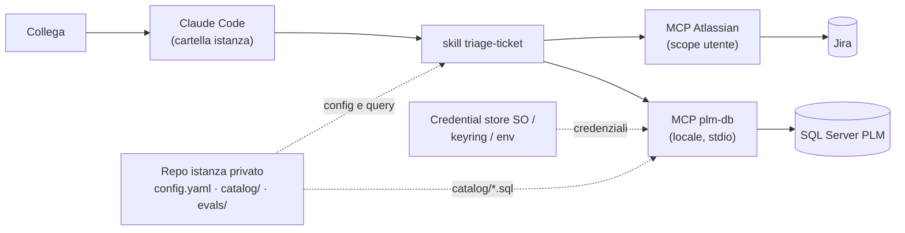

# Architettura

Tutto gira sul PC del collega, in rete aziendale. Claude Code è aperto nella cartella del repo istanza privato; il plugin pubblico porta la procedura (skill) e il server MCP locale per il DB.

## Componenti

| Componente | Dove | Ruolo |
|---|---|---|
| Plugin `plm-triage` | questo repo, installato via marketplace | skill `triage-ticket` e `setup`, dichiara il server `plm-db` in `.claude-plugin/plugin.json` |
| Server `plm-db` | `server/`, avviato da Claude Code con `uv run` | unico accesso al DB: `ping`, `list_queries`, `describe_query`, `run_query`. Nessun SQL libero ([ADR 0002](adr/0002-db-via-mcp-catalogo.md)) |
| Repo istanza | privato, uno per team | `config.yaml` (Jira, categorie, escalation), `catalog/*.sql`, `evals/`, `.claude/settings.json` ([ADR 0004](adr/0004-template-pubblico-istanza-privata.md)) |
| MCP Jira | registrato dal setup a scope utente | Rovo MCP (Cloud, OAuth) o `sooperset/mcp-atlassian` (Data Center, PAT) ([ADR 0005](adr/0005-jira-via-mcp-atlassian.md)) |
| Credenziali DB | fuori dal repo | userConfig `sensitive`, keyring, env per headless ([ADR 0003](adr/0003-credenziali-fuori-dal-repo.md)) |

## Flusso di un triage

1. Preflight fail-closed: config, `ping`, catalogo, lettura del ticket.
2. Classificazione in una categoria di `config.yaml`; solo le query di quella categoria.
3. Evidenze etichettate `verificato` / `dedotto` / `ipotesi`, con fonte.
4. Trigger di escalation a regole; altrimenti bozza solo se tutto è `verificato`.
5. File di run in `evals/runs/`; in `shadow` nessuna scrittura Jira, in `live` ogni scrittura approvata dall'umano ([ADR 0006](adr/0006-autonomia-graduale-gate.md)).

## Confini di sicurezza

- Il vero confine sul DB è il login in sola lettura (da verificare con il DBA); il parser del catalogo è difesa in profondità.
- Il testo del ticket è dato non fidato: la skill non usa Bash (che non è pre-autorizzato: ogni comando chiede conferma), tool web negati nell'istanza, nessun SQL libero, scritture Jira negate in shadow.
- Dettagli in [SECURITY.md](../SECURITY.md).

## Prossimi passi (fuori dalla 0.1.0)

Fase headless, solo dopo il gate e un periodo di bozze: `claude -p` schedulato su una macchina in rete aziendale, con service account Jira dedicato, allowlist `--allowedTools`, idempotenza tramite etichetta (`ai-triaged`), alert su errori e preflight falliti.
