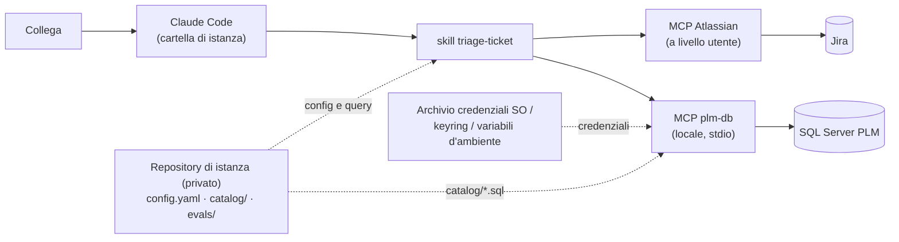

# Architettura

Tutto gira sul PC del collega, in rete aziendale. Claude Code viene aperto nella cartella di istanza, cioè il clone locale del repository privato del team. Il plugin pubblico fornisce la procedura (le skill) e il server MCP locale che interroga il database.

## Termini usati

- **Istanza**: la configurazione di un team (`config.yaml`, catalogo query, valutazioni). Vive in un **repository di istanza** privato; il clone locale è la **cartella di istanza** (opzione `instance_dir`).
- **Catalogo**: l'elenco delle query SQL approvate dal team, una per file in `catalog/`. È l'unico modo di leggere il database.
- **Punto di controllo**: momento del setup in cui Claude si ferma e aspetta una decisione o un'azione di una persona.
- **Controlli preliminari**: verifiche fatte prima di ogni triage; se una fallisce, il triage si ferma senza produrre nulla.
- **Modalità di prova** (`mode: shadow`): il triage scrive solo un file di traccia locale, mai su Jira. **Modalità operativa** (`mode: live`): il triage può scrivere su Jira, con la conferma dell'utente per ogni scrittura.
- **Valutazione di prova**: triage di ~30 ticket chiusi in modalità di prova, giudicati da una persona. Il **via libera** è la decisione di passare alla modalità operativa, se i risultati superano le soglie.
- **Collaudo**: primo uso in modalità operativa su 1-3 ticket aperti.
- **Passaggio di consegne**: il commento con cui Claude affida un ticket a una persona (escalation).

## Componenti

| Componente | Dove | Ruolo |
|---|---|---|
| Plugin `plm-triage` | questo repository, installato dal marketplace | skill `triage-ticket` e `setup`; dichiara il server `plm-db` in `.claude-plugin/plugin.json` |
| Server `plm-db` | `server/`, avviato da Claude Code con `uv run` | unico accesso al database, con quattro tool: `ping`, `list_queries`, `describe_query`, `run_query`. Nessun SQL libero ([ADR 0002](adr/0002-db-via-mcp-catalogo.md)) |
| Repository di istanza | privato, uno per team | `config.yaml` (Jira, categorie, escalation), `catalog/*.sql`, `evals/`, `.claude/settings.json` ([ADR 0004](adr/0004-template-pubblico-istanza-privata.md)) |
| Server MCP per Jira | registrato dal setup a livello utente | Rovo MCP (Cloud, OAuth) oppure `sooperset/mcp-atlassian` (Data Center, token personale) ([ADR 0005](adr/0005-jira-via-mcp-atlassian.md)) |
| Credenziali del database | fuori dai repository | opzioni del plugin (password `sensitive`), keyring, variabili d'ambiente per l'esecuzione automatica ([ADR 0003](adr/0003-credenziali-fuori-dal-repo.md)) |

## Come funziona un triage

1. Controlli preliminari bloccanti: configurazione, `ping` del database, catalogo, lettura del ticket.
2. Il ticket viene assegnato a una categoria di `config.yaml`; si eseguono solo le query di quella categoria.
3. Ogni evidenza è etichettata `verificato`, `dedotto` o `ipotesi`, con la sua fonte.
4. Si controllano le condizioni di escalation, che sono regole fisse. Se nessuna scatta, Claude prepara una bozza di risposta, ma solo se tutto è `verificato`.
5. Claude salva un file di traccia in `evals/runs/`. In modalità di prova non scrive su Jira; in modalità operativa ogni scrittura va approvata dall'utente ([ADR 0006](adr/0006-autonomia-graduale-gate.md)).

## Confini di sicurezza

- Sul database il vero confine è il login in sola lettura, da verificare con il DBA. I controlli del server sul catalogo sono una difesa in più.
- Il testo del ticket non è affidabile: la skill non usa Bash (che non è pre-autorizzato: ogni comando chiede conferma), i tool web sono negati nell'istanza, non esiste SQL libero e in modalità di prova le scritture su Jira sono negate.
- Dettagli in [SECURITY.md](../SECURITY.md).

## Sviluppi futuri (dopo la 0.1.0)

Esecuzione automatica, solo dopo il via libera e il periodo di rodaggio: `claude -p` pianificato su una macchina in rete aziendale, con account di servizio Jira dedicato, elenco chiuso di tool consentiti (`--allowedTools`), etichetta `ai-triaged` per non trattare due volte lo stesso ticket, avvisi in caso di errori o di controlli preliminari falliti.
